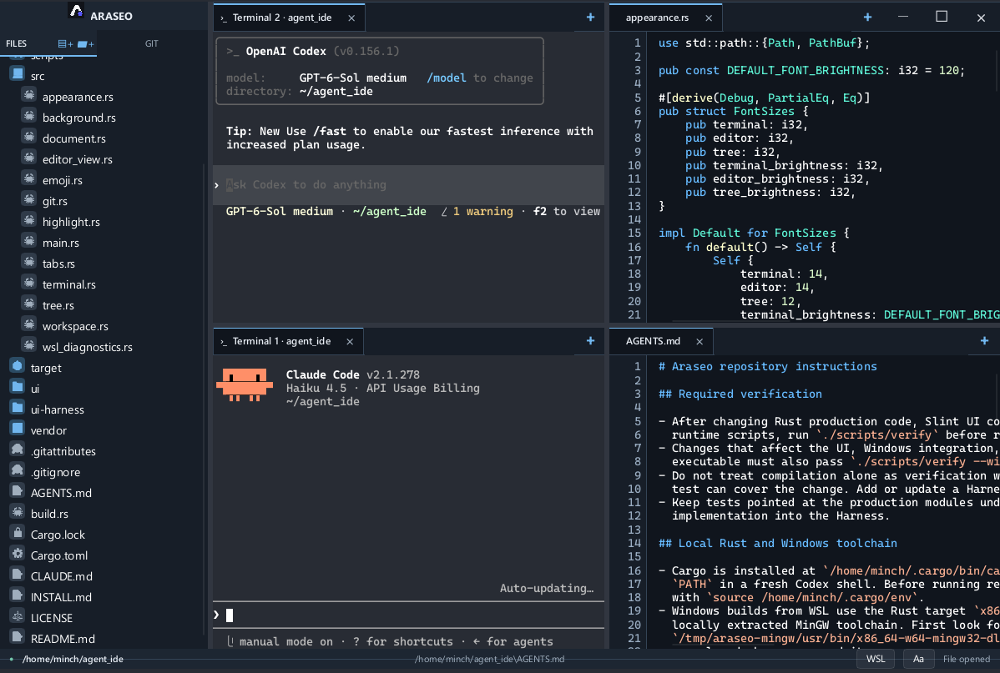
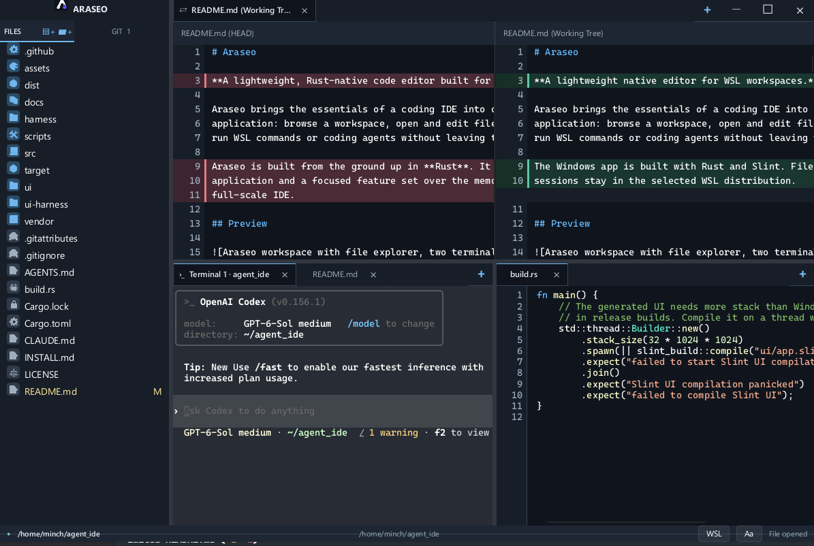

# Araseo

**A lightweight native editor for WSL workspaces.**

Araseo brings the essentials of a coding IDE into one fast, focused desktop
application: browse a workspace, open and edit files, inspect Git changes, and
run WSL commands or coding agents without leaving the window.

The Windows app is built with Rust and GPUI Kit. Files, Git commands, and terminal
sessions stay in the selected WSL distribution.

## Preview

These screenshots illustrate workspace layouts from the earlier frontend.
The current build uses GPUI Kit; see the feature descriptions below for its
updated controls and behavior.



Two terminal sessions alongside source files in a split workspace.



A Git change compared between `HEAD` and the working tree, with a terminal and
source file open in the panes below.

## What it does

- Browse a lazy-loading file tree. Create or rename entries, delete them after
  confirmation, copy a Linux path, or drop files from Windows Explorer.
- Edit files in tabs with line numbers, syntax highlighting, find, undo and
  redo. Open files are refreshed when disk changes are detected; unsaved edits
  are protected by a reload or overwrite choice.
- Inspect changes grouped by project or Git repository, including repositories
  nested inside the workspace. Groups show their path and change count and can
  be collapsed. File rows show their relative folder and status. Open a
  side-by-side diff or discard a change after confirmation. Both diff columns
  fit the current pane width, wrapping long lines when the pane is resized.
- Run independent WSL terminals in tabs. PTY and VT100 rendering support
  interactive programs, ANSI colors, Korean text, IME input, and selection.
  Codex and Claude Code tabs display their original logos. During active work,
  the logo rotates once per 800 ms, with animation updates capped at 10 Hz.
  It stays still while waiting for input or approval, when the window is
  inactive, or when reduced motion is enabled. The logo disappears when the
  agent exits. Araseo passes session-scoped activity hooks
  to these CLIs without changing their saved configuration. Codex may ask you
  to trust the hooks through `/hooks` before its activity can be shown.
- Arrange file, diff, and terminal tabs in repeatable horizontal or vertical
  splits, with a separate tab bar and resizable dividers in each pane.
- Open read-only WSL diagnostics from the status bar, including disk, memory,
  processes, running distributions, Git, and available Docker information.

## Install and open a workspace

Araseo requires Windows 10 version 1809 or newer, or Windows 11, with WSL2.
Ubuntu is the documented setup. The terminal uses `/bin/bash` and
`/usr/bin/script`, and automatic file and Git refresh uses `/usr/bin/python3`
inside the selected distribution.

From WSL, install the newest release with:

```bash
curl -fsSL https://github.com/mincheol-lee/araseo/releases/latest/download/install.sh | sh
araseo .
```

Run `araseo path/to/project` to open another directory, or
`araseo path/to/file.rs` to open a file in its parent directory. The launcher
uses the current WSL distribution and converts the path for the Windows app.

The install command also updates an existing installation. It verifies release
checksums, places the executable under Windows LocalAppData, and installs the
`araseo` launcher in `~/.local/bin`. See [INSTALL.md](INSTALL.md) for pinned
versions, manual installation, and removal.

## Using Araseo

Tabs, **New Terminal (+)**, and minimize/maximize/close controls share a compact
top row. The Windows executable embeds the Araseo logo for the native window
and taskbar icon.

- Click a file in the tree to open it. Use the **FILES** toolbar or an item's
  context menu for file operations. The **New File** and **New Folder** icons
  create entries in the selected directory, or the selected file's parent.
  Drag a file from the tree into a terminal to paste its Linux path.
- Click **Add Project** in the **FILES** toolbar to add another folder in the
  same WSL distribution. On Windows, choose **Browse...** to select a folder in File
  Explorer, or enter its absolute Linux path (for example,
  `/home/user/other-project`). Added folders appear as separate roots in the
  tree, with their own Git changes. Right-click an added root and select
  **Remove Folder** to remove it from the window without deleting its files.
  Use **Open Terminal Here** in a folder's context menu to start in that folder.
  Araseo remembers added folders for each starting workspace and WSL
  distribution, then restores accessible folders the next time it opens.
- Press `Ctrl+S` to save, `Ctrl+F` to find in the active file, and `Ctrl+Z`
  or `Ctrl+Y` to undo or redo. `Ctrl+Tab` and `Ctrl+Shift+Tab` cycle tabs.
- Select **GIT** in the sidebar to browse changed and untracked files. Click
  a project heading to collapse or expand its changes, or a file to open its
  diff. The **HEAD** and **Working Tree** sides reflow to the current window or
  split-pane width; copying text preserves the original unwrapped source.
- Drag a tab to a pane edge to split the workspace, or to the center of a pane
  to move it there. Drag a divider to resize the panes. Use the top-right **+**
  or `Ctrl+Shift+T` to start another terminal. Moving a terminal preserves its
  session, immediately updates its grid to the destination pane, and transfers
  input focus so the next keystroke reaches the same running program.
- Drag a tab left or right within its pane's tab bar to reorder it. The blue
  insertion line shows the drop position; dragging into the content area still
  docks or splits the pane. The order is saved with the workspace session.
- Codex launched with `codex` uses the terminal's supported legacy key protocol
  (`CODEX_TUI_DISABLE_KEYBOARD_ENHANCEMENT=1`) by default. An existing value
  is respected, and this affects only that command. Terminal output uses one
  painted surface with cached shaping for unchanged rows.
- Claude launched with `claude` in an Araseo terminal defaults to
  `CLAUDE_CODE_NATIVE_CURSOR=1` so IME composition follows its input caret.
  Existing values of that environment variable are respected. This is scoped
  to the command and does not edit Claude or Windows settings. See the
  [Claude cursor option](https://code.claude.com/docs/en/env-vars).
- Scroll terminal output with the mouse wheel. Apps that request mouse capture
  receive wheel events in their requested terminal protocol; otherwise the wheel
  reads retained output. Hold **Shift** while scrolling to read local history
  even when an app captures the mouse. Main and alternate screen history are
  separate and capped at 10,000 displaced rows each; a new alternate-screen
  session starts with fresh history. Local history only contains rows the app
  has scrolled off screen, not transcript content it has never rendered.
- Use **Aa** in the status bar to set terminal, editor, and file tree font size
  and brightness independently; **Reset defaults** restores the initial values.
  Use **WSL** to request environment diagnostics.

The editor accepts UTF-8 text files up to 2 MiB and preserves LF or CRLF line
endings. Binary files and files with invalid UTF-8 cannot be edited. Araseo
opens one workspace per window; language-server features and extensions are
outside its current scope.

## Development

Prerequisites:

- Rust stable
- Windows 10 1809+ or Windows 11
- WSL2 with an Ubuntu distribution

Build the native application on Windows:

```powershell
.\scripts\build-windows.ps1
```

This produces `dist/araseo.exe`.

The PowerShell build script runs the core Harness tests before building the
Windows executable. For a development checkout, put `scripts/araseo` on the WSL
`PATH`; it will use `dist/araseo.exe`. If the executable is elsewhere, set
`ARASEO_EXE` to its WSL interop path:

```bash
export ARASEO_EXE=/mnt/c/Tools/Araseo/araseo.exe
araseo .
```

For UI development on Linux/WSLg, `cargo run -- .` opens the current Linux
directory and uses a Unix PTY instead of ConPTY.

Ubuntu development builds require Fontconfig and pkg-config headers:

```bash
sudo apt install pkg-config libfontconfig1-dev libfreetype-dev libxkbcommon-dev libxkbcommon-x11-dev libxcb1-dev libwayland-dev
```

Run the core and GPUI UI Harness tests, plus release installer tests:

```bash
./scripts/verify
```

The tests use the production modules for editor, file tree, workspace, Git,
terminal, and UI behavior. Linux verification uses the development packages
listed above to link the native GPUI test platform.

Before distributing a Windows build, verify both targets:

```bash
./scripts/verify --windows
```

Windows release builds require the Windows SDK HLSL compiler (`fxc.exe`). The
vendored GPUI Windows build script also supports WSL cross builds with MinGW
and a Windows SDK on the host; `GPUI_FXC_PATH` can override its compiler path.
The application itself does not require the SDK or administrator privileges.

For native Windows input, docking, session restore and resize checks, copy the
release executable to a Windows local folder and run:

```powershell
.\scripts\test-windows-workbench.ps1 -Executable C:\Tests\araseo.exe -OutputDirectory C:\Tests\gpui-results
```

The script creates a private WSL workspace and settings directory, drags a
running terminal into a lower split, verifies native typing and shell input,
reopens the saved layout, and compares captures before and after forced
repaints. It closes only its own app processes. Do not interact with the test
window while it runs. The `test-windows-terminal-input.ps1` and `test-windows-resize.ps1` wrappers
also accept the production executable. Korean IME event semantics have
headless regression tests; physical IME composition must additionally be
checked on the affected Windows keyboard/IME combinations.

Use `-Mode Git` to check project groups, collapse/expand, and diff reflow after
resizing. Use `-Mode Agent` to check Claude/Codex tab logos, rotation during
work, stopping while waiting, and removal after exit. The agent fixture uses
terminal-local process names and activity files without contacting either
agent service. Each mode also checks that the native window has its app icon.

For Windows-to-WSL resize latency verification, build the headless fixture
`harness/examples/windows_resize_latency.rs` with the Windows target, then run
it on Windows with the WSL distribution name as its argument. It uses a private
Python 3 PTY, verifies the foreground resize signal and final size, and compares
fresh WSL commands with the persistent resize pipe. It does not start Codex or
access an existing terminal. The persistent pipe sleeps while idle and closes
when its terminal is dropped; failures use the previous command path and retry
connecting after a five-second cooldown.

Pushing a `v`-prefixed tag matching the version in `Cargo.toml` runs the
release workflow: it verifies Linux and Windows targets, builds the Windows
executable, and publishes the GitHub Release assets. A suffix such as
`-beta.1` marks a pre-release.

The app uses Rust for workspace, document, Git, and terminal logic and GPUI
Kit for its native UI. Windows rendering uses GPUI's DirectX backend. Each
terminal has one custom painted surface, a persistent native IME handler, and
cached runs for unchanged rows. PTY parsing and protocol replies remain on
workers. Docked content uses GPUI view caching, and the agent logo has a separate
view with capped animation updates so rotation can reuse cached terminal content.
See [docs/GPUI-PORT.md](docs/GPUI-PORT.md) for the migration and validation notes.

Font settings are saved in `%LOCALAPPDATA%/araseo/fonts.conf` on Windows or
`$XDG_CONFIG_HOME/araseo/fonts.conf` on Linux (default:
`~/.config/araseo/fonts.conf`). The original MVP specification is in
[docs/PRD.md](docs/PRD.md); it predates several features described here.

On normal exit, Araseo saves each workspace's open file and terminal tabs,
tab selection and split layout, sidebar width, and window size under
`%LOCALAPPDATA%/araseo/sessions` (or `$XDG_CONFIG_HOME/araseo/sessions` on Linux).
Unsaved editor text is restored, and changes to the disk copy still require
conflict resolution before saving. Terminal tabs start new shells in their
original folders; running commands and terminal history cannot resume. Git
diff tabs are reopened from current repository state.

In **WSL environment**, each process owned by your WSL user has a **Stop**
button. Confirm with **Terminate** for a normal exit request, or **Force kill**
for immediate termination. The snapshot refreshes after the action. No admin
privileges are needed. This feature requires Python 3.9+ and pidfd support in
that WSL distribution; diagnostics still work without them.

For crash investigation, Araseo writes a small local log to
`%LOCALAPPDATA%\araseo\logs\araseo.log` on Windows (or
`$XDG_STATE_HOME/araseo/logs/araseo.log` on Linux, defaulting to
`~/.local/state/araseo/logs/araseo.log`). It records startup, normal exit,
window focus, event-loop pauses, Rust panics with backtraces, and unhandled
Windows exception codes, thread IDs, module names, relative addresses (RVA),
and the access type/target for access violations when available. Startup records
also identify the source revision. Matching debug symbols are retained in
`dist/` for local builds and in the separate symbols archive for GitHub releases.
These breadcrumbs help locate a fault; they do not replace a crash dump. It does not
record editor text or terminal output. Once the log reaches 1 MiB, the next
launch moves it to `araseo.previous.log`. A native access violation may end the
process without a final log entry; the last timestamp still helps narrow down
what the app was doing.

## Support

If Araseo is useful to you and you'd like to support its development, you can
[buy me a coffee](https://buymeacoffee.com/mclee). Araseo remains free to use.
